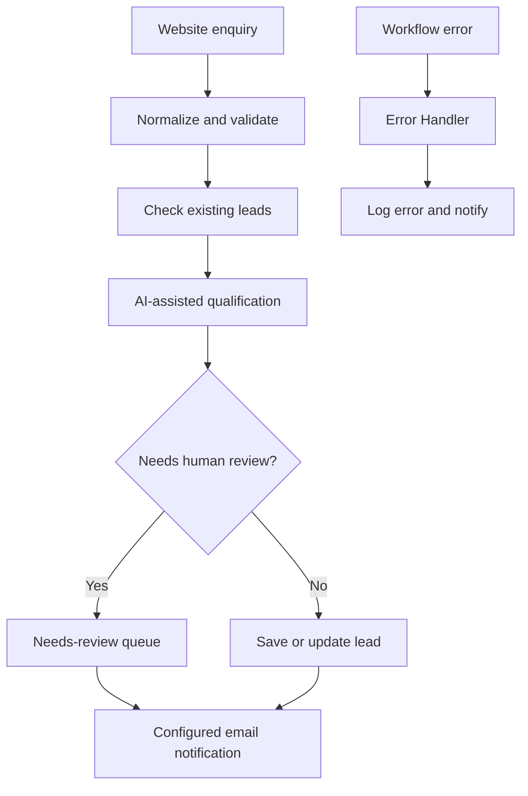

# LeadPilot
### AI-assisted lead management automation for service businesses

LeadPilot is an n8n automation project that helps small service businesses process incoming enquiries, qualify leads, keep records organized, and route cases that need human attention.

It focuses on **lead management and qualification** — not lead generation.

## Product walkthrough

[▶ Watch the LeadPilot dashboard walkthrough](./LeadPilot%20Dashboard%20Demo.mp4)

The video is included in this repository.

## What LeadPilot demonstrates

- **Website lead intake** — receive enquiries through a web form.
- **Data normalization** — standardize and validate submitted lead details.
- **Duplicate detection** — identify returning or previously recorded leads.
- **AI-assisted qualification** — evaluate incoming leads and structure qualification results.
- **Needs-review handling** — route incomplete or uncertain records for human review.
- **Lead record management** — store and update lead information in Google Sheets.
- **Email communication** — send configured lead alerts and responses.
- **Error handling** — capture workflow failures for logging and notification.

## How the workflow operates

## Technology

| Component | Purpose |
| --- | --- |
| n8n | Workflow orchestration |
| Google Sheets | Lead records and workflow configuration |
| Gmail | Optional email intake and notifications |
| AI API | Lead qualification |
| Web form | Website enquiry capture |

Integrations require the operator's own credentials and configuration. The Gmail intake trigger is disabled by default in the supplied workflow export.

## Repository contents

- `LeadPilot Dashboard Demo.mp4` — dashboard walkthrough.
- `README.md` — project overview and workflow summary.

The operational n8n workflow exports are maintained separately and are not published in this public case-study repository.

## Project scope and status

This repository documents a working automation project and its demonstrated capabilities. It is not a claim that a fully hosted, generally available multi-tenant SaaS product is currently available.

## Security

The public case study does not include operational credentials, OAuth tokens, customer records, private webhook URLs, or production configuration. Anyone implementing a similar workflow should use their own credentials and test configuration before enabling live triggers.

## License

No open-source license is granted by this repository. All rights reserved by the repository owner unless otherwise stated.
